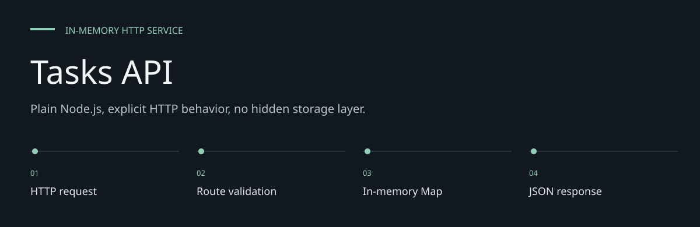
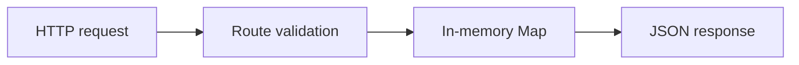

# Tasks API

**Plain Node.js, explicit HTTP behavior, no hidden storage layer.**

> Plain Node.js, zero runtime dependencies, explicit HTTP behavior.
> Tasks exist only for the lifetime of one server process.

A small tasks service for learning and testing HTTP APIs. It lists tasks, creates them from a
validated title, and exposes a health endpoint. The implementation uses Node's HTTP server,
UUID generation and a Map rather than a framework or database.


[Architecture](docs/ARCHITECTURE.md) · [Evaluation guide](docs/EVALUATION.md)

**Contents:** [The challenge](#the-challenge) · [Walkthrough](#walk-through-the-project) ·
[Implementation](#implementation-state) · [Design choices](#engineering-choices) ·
[Next evidence](#next-evidence-to-collect)

---

## The challenge

A small API is a useful way to inspect request validation, response contracts and isolated tests
without framework machinery. This service makes its storage lifetime and three supported routes
explicit, so learning behavior is not confused with production persistence or authorization.

## System at a glance



## Walk through the project

### 1. Check health

Start the process and request GET /health. A health response establishes process behavior, not
database connectivity or service uptime.

### 2. Create a task

POST a JSON object with a nonblank title. The service trims it, assigns a UUID, sets done false
and records a creation timestamp.

### 3. List the store

GET /tasks returns tasks from the current app store. A fresh app has an empty store; there is no
cross-process persistence.

### 4. Inspect failure paths

Malformed JSON, missing/non-string/blank titles and unsupported routes have explicit error
responses. The exported title-length constant is not enforced.

## Evaluate locally

Requires Node.js **24 or newer**, as declared in [package.json](package.json).
From the repository root:

```sh
npm test
npm start
```

In another terminal:

```sh
curl http://localhost:3000/health
curl http://localhost:3000/tasks
curl -X POST http://localhost:3000/tasks \
  -H 'Content-Type: application/json' -d '{"title":"Write tests"}'
```

Expected: health returns `{"status":"ok"}`, a fresh store returns `{"tasks":[]}`, and creation
returns HTTP 201 with `id`, a trimmed `title`, `done: false` and an ISO `createdAt` timestamp.
Use `PORT=3001 npm start` to choose another port. Restarting empties the store.

**Verified 7 October 2026:** `npm test` passed **10/10 tests**, with zero failures or skips,
using Node v26.0.0. This checks local HTTP behavior, not deployment or load capacity.

## API contract

| Method and path | Result |
|---|---|
| `GET /health` | 200, process health response |
| `GET /tasks` | 200, array of tasks in the current process |
| `POST /tasks` | 201 for a nonblank string title; 400 for invalid/missing input |
| Other routes | 404, JSON error |

Create requests should be JSON objects. Invalid JSON, missing titles, non-string titles and
whitespace-only titles are rejected. The response has a JSON content type.

## How it works

`HTTP request → route/body validation → in-memory Map → JSON response`.

[server.js](server.js) exposes `createApp()` for an isolated server and `createTaskStore()` for
storage. Starting the file directly listens on `PORT` or 3000. Each app has its own store.
[server.test.js](server.test.js) exercises health, empty listing, creation, retrieval through the
list, distinct IDs, invalid titles/JSON and missing routes.

## Scope and limits

- Built: health, list and create routes; local behavior tests; GitHub Actions workflows.
- Absent: update/delete endpoints, completion changes, persistence, authentication and pagination.
- `MAX_TITLE_LENGTH` is exported but not enforced by the creation route.
- Request bodies are accumulated without an explicit size limit. This is a learning service;
  the README does not establish readiness for untrusted production traffic.
- The listener does not restrict its bind address to localhost. Choose deployment exposure
  deliberately; there is no per-user authorization or database isolation.

## Repository and CI

| Path | Purpose |
|---|---|
| `server.js` | Server, routing and task store |
| `server.test.js` | Ten HTTP behavior tests |
| `package.json` | Runtime requirement and start/test commands |
| `.github/workflows/ci.yml` | Tests on pushes and pull requests |
| `.github/workflows/agent-pr.yml` | Agent-branch pull request workflow |
| `AGENTS.md` | Contribution and branch rules |

See [AGENTS.md](AGENTS.md) before contributing. The project has no install step for runtime
packages, and no published uptime or performance measurements.

## Engineering choices

**Framework-free HTTP.** Node primitives keep route/store behavior visible.

**Isolated app stores.** Each created app can be tested without shared global task state.

**Limits are explicit.** An exported constant is not proof that a validation rule enforces it.

## Implementation state

| State | Current evidence |
| --- | --- |
| Present | Health/list/create routes and isolated stores |
| Measured | Ten local HTTP behavior tests passed on 7 October 2026 |
| Not present | Update/delete, persistence and per-user auth |
| Not established | Production body limits, title cap or load capacity |

The [architecture guide](docs/ARCHITECTURE.md) maps these statements to source entry points.
The [evaluation guide](docs/EVALUATION.md) separates inspection, executable checks and
domain validation, with the next evidence needed for each project.

## Next evidence to collect

- Record deployment/body-limit assumptions if expanding beyond learning use.
- Test persistence and authorization only after they are implemented.
- Retain explicit error-path behavior in future changes.

## Recorded checks — 7 October 2026

| Check | Observation |
| --- | --- |
| HTTP behavior | 10 passed, 0 failed, 0 skipped |

Commands used:

```text
npm test
```

These results cover the listed software paths. They do not establish live deployment,
external-service compatibility, accessibility conformance or domain efficacy.
