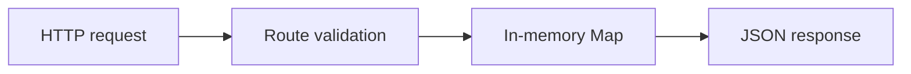

# Tasks API — Architecture and implementation

This guide follows the tracked implementation. Proposed work is identified separately.

## The problem and the system boundary

A small API is a useful way to inspect request validation, response contracts and isolated tests
without framework machinery. This service makes its storage lifetime and three supported routes
explicit, so learning behavior is not confused with production persistence or authorization.

## Processing path

## End-to-end behavior

### 1. Check health

Start the process and request GET /health. A health response establishes process behavior, not
database connectivity or service uptime.

### 2. Create a task

POST a JSON object with a nonblank title. The service trims it, assigns a UUID, sets done false
and records a creation timestamp.

### 3. List the store

GET /tasks returns tasks from the current app store. A fresh app has an empty store; there is no
cross-process persistence.

### 4. Inspect failure paths

Malformed JSON, missing/non-string/blank titles and unsupported routes have explicit error
responses. The exported title-length constant is not enforced.

## Design choices and consequences

### Framework-free HTTP

Node primitives keep route/store behavior visible.

### Isolated app stores

Each created app can be tested without shared global task state.

### Limits are explicit

An exported constant is not proof that a validation rule enforces it.

## Source entry points

### [server.js](../server.js)

This file is part of the reviewed path described above. Follow its imports and calls
for the exact interface rather than inferring behavior from the filename.

### [server.test.js](../server.test.js)

This file is part of the reviewed path described above. Follow its imports and calls
for the exact interface rather than inferring behavior from the filename.

### [package.json](../package.json)

This file is part of the reviewed path described above. Follow its imports and calls
for the exact interface rather than inferring behavior from the filename.

## Implementation state

| State | Evidence boundary |
| --- | --- |
| Present | Health/list/create routes and isolated stores |
| Measured | Ten local HTTP behavior tests passed on 7 October 2026 |
| Not present | Update/delete, persistence and per-user auth |
| Not established | Production body limits, title cap or load capacity |

“Present” means tracked source or assets exist. It does not mean a production or domain
validation has passed. See [Evaluation](EVALUATION.md) for reproducible checks and limits.
